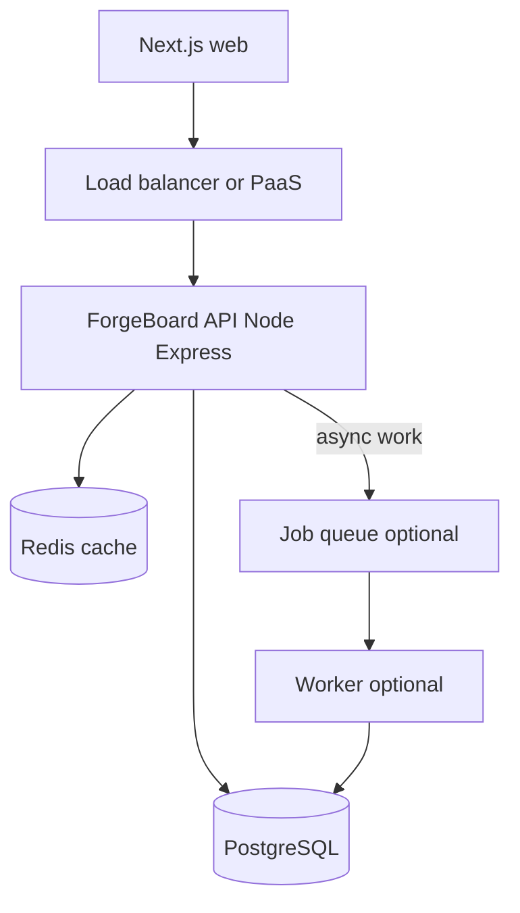

# ForgeBoard — system design whiteboard

Portfolio capstone: a simplified Linear/Jira-style **team issue tracker API** (+ Next.js UI).  
Use this doc to practice interviews; implement it in `apps/forgeboard-api` and `apps/forgeboard-web`.



---

## 1. Requirements

### Functional (MVP)

- Register / login (JWT access + refresh)
- Workspaces with members and roles: `owner` | `admin` | `member`
- Projects inside a workspace
- Issues: title, description, status, priority, assignee, labels
- Comments on issues
- List/filter/paginate issues (`status`, `assignee`, `q`)

### Non-functional (interview talking points)

| Concern | Target for portfolio |
|---|---|
| Latency | p95 list-issues &lt; ~300ms with warm cache |
| Availability | Single-region PaaS is fine; design for horizontal API replicas |
| Consistency | Strong for writes (Postgres); cache is eventually consistent |
| Security | Hash passwords; membership checks on every mutating route |
| Operability | Structured logs, `/health`, `/ready`, migrations on deploy |

### Out of scope for MVP (mention as stretch)

- Real-time websockets, full-text search engine, S3 file blobs, SSO/OAuth

---

## 2. High-level components

| Piece | Choice | Why |
|---|---|---|
| API | Express + TypeScript | Matches learning path; easy to hire for |
| DB | PostgreSQL + Prisma | Relational membership + issues fit SQL |
| Cache | Redis | Hot “issues in project” lists |
| Web | Next.js App Router | Portfolio demo UI; API stays separate |
| Jobs | BullMQ + Redis (stretch) | Digests, webhooks, email stubs |

Keep **business logic in the API**, not in Next Route Handlers — same rule as Phase 4/5.

---

## 3. Data model (sketch)

```text
User
  id, email, password_hash, name, created_at

Workspace
  id, name, slug, created_at

WorkspaceMember
  workspace_id, user_id, role   -- PK (workspace_id, user_id)

Project
  id, workspace_id, name, key, created_at

Issue
  id, project_id, number, title, body, status, priority,
  assignee_id?, reporter_id, created_at, updated_at

Label
  id, project_id, name, color

IssueLabel
  issue_id, label_id

Comment
  id, issue_id, author_id, body, created_at
```

**Indexes (call these out in interviews):**

- `WorkspaceMember(user_id)` — “my workspaces”
- `Issue(project_id, status)` — board filters
- `Issue(project_id, assignee_id)`
- Unique `(project_id, number)` for human-friendly keys (`PROJ-42`)

---

## 4. API shape (REST)

```text
POST   /auth/register|login|refresh|logout
GET    /auth/me

POST   /workspaces
GET    /workspaces
POST   /workspaces/:id/members
GET    /workspaces/:id/members

POST   /workspaces/:wid/projects
GET    /workspaces/:wid/projects

GET    /projects/:pid/issues?status=&assignee=&q=&page=
POST   /projects/:pid/issues
GET    /issues/:id
PATCH  /issues/:id
POST   /issues/:id/comments
```

**AuthZ rule:** resolve membership for the workspace that owns the project/issue **before** mutate. Admins/owners can manage members; members can CRUD issues in that workspace (tune as you like, but be consistent).

---

## 5. Hot paths & caching

| Path | Strategy |
|---|---|
| `GET /projects/:pid/issues` | Cache-aside in Redis, key includes filters + page; TTL 15–60s |
| Writes to issues/comments | Invalidate that project’s issue-list keys (same pattern as Phase 5 feed) |
| `GET /auth/me` | No cache needed; cheap |

**Interview line:** “Cache is a performance optimization, not source of truth. Postgres wins on conflict.”

---

## 6. Background work (stretch)

Examples that look strong on a whiteboard:

- After issue create → enqueue `issue.created` for webhook stub / digest email
- Nightly “stale issue” report per workspace

Worker process shares Redis; API stays request/response fast.

---

## 7. Scaling story (junior/mid depth)

1. **Vertical:** bigger API box (fine early)  
2. **Horizontal:** N API replicas behind a load balancer; **stateless** JWT (no sticky sessions required)  
3. **DB:** connection pooling; later read replica for heavy list reads  
4. **Cache:** Redis absorbs list QPS  
5. **Queue:** absorb spikes for non-user-facing work  

What **not** to say: “We’ll use Kubernetes and microservices on day one.” Start simple; name the next bottleneck.

---

## 8. Failure modes

| Failure | Behavior |
|---|---|
| Redis down | Degrade: skip cache, hit Postgres; `/ready` can still pass or mark redis degraded — pick and document |
| Postgres down | `/ready` → 503; no writes |
| Duplicate refresh reuse | Rotate/revoke refresh tokens (Phase 4 pattern) |
| IDOR | Membership middleware on every nested resource |
| Slow Node work | Don’t CPU-hash in a tight loop on the request path beyond bcrypt; offload heavy jobs |

---

## 9. Observability

- Request ID on every log line (Phase 5 pino pattern)
- Metrics later: request latency, cache hit ratio, queue depth
- Alerts: elevated 5xx, failed migrations, disk on Postgres

---

## 10. Implementation map in this repo

| Area | Package |
|---|---|
| API | `apps/forgeboard-api` |
| Web | `apps/forgeboard-web` |
| Shared UI | `packages/ui` |
| Deploy patterns | Reuse Phase 6 Dockerfile / Compose / `docs/DEPLOY.md` |

When you start the capstone, implement against this design and update this file if reality diverges (that’s normal).
